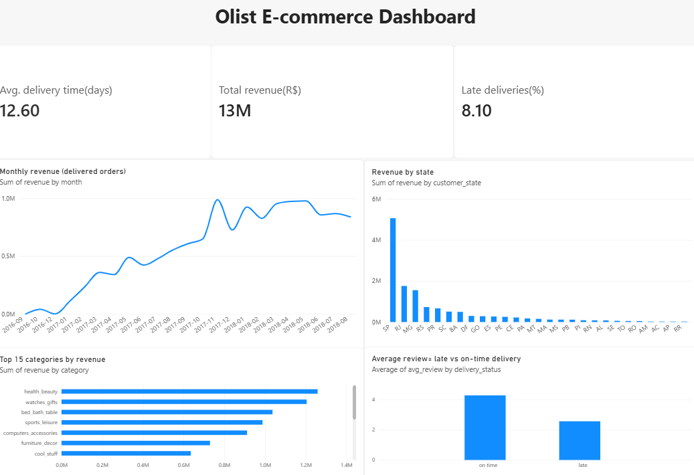

# Olist E-Commerce Analysis (SQL + Power BI)
Built as a personal portfolio project during my M.Sc. in Business Intelligence and Data Science

Analysis of the public Brazilian e-commerce dataset by Olist (about 100,000 orders, 2016-2018) to answer business questions on revenue, delivery and customer satisfaction.

## Business questions
1. Is revenue growing, and which product categories drive it?
2. How long does delivery take, and how often is it late?
3. Do late deliveries lead to worse reviews?
4. Which states bring the most revenue?
5. How many customers come back?

## Key insights
- **Growth:** Monthly revenue grew through 2017 and levelled off at about R$ 0.97-0.99M in 2018 (peak: November 2017, R$ 987,765). The near-zero months in late 2016 reflect the start of the dataset, not a real decline.
- **Delivery:** Orders take 12.6 days on average, and 8.1% arrive after the estimated date.
- **Satisfaction:** Late orders average a review score of 2.57, versus 4.29 for on-time orders. The data shows a strong association; it doesn't prove lateness is the only cause.
- **Geography:** Sao Paulo generates about 38% of revenue (R$ 5.07M of R$ 13.2M), followed by Rio de Janeiro and Minas Gerais.
- **Retention:** Only 3.0% of customers order more than once (2,801 of 93,358), so most revenue comes from one-time buyers.

## Method
- Loaded the CSV files into SQLite and wrote SQL queries (joins, aggregations, CASE WHEN, subqueries): see `olist_queries.sql`.
- Exported the query results and built a Power BI dashboard: see `olist_dashboard.pbix`.
- Revenue figures use delivered orders only, except the category chart, which includes all order statuses.

## Tools
SQL (SQLite, DB Browser), Power BI Desktop

## Data
Brazilian E-Commerce Public Dataset by Olist, from Kaggle: https://www.kaggle.com/datasets/olistbr/brazilian-ecommerce
